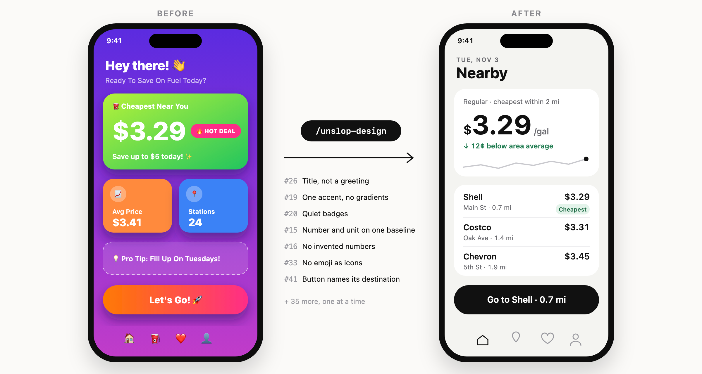
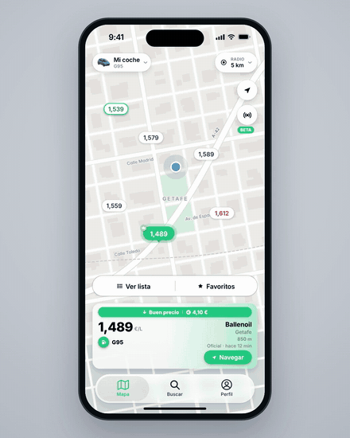
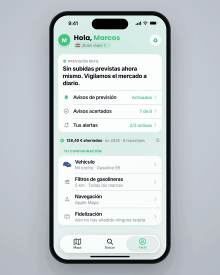
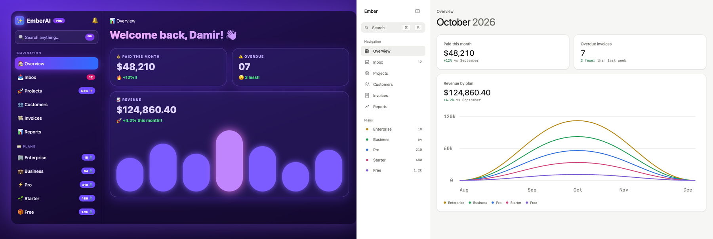
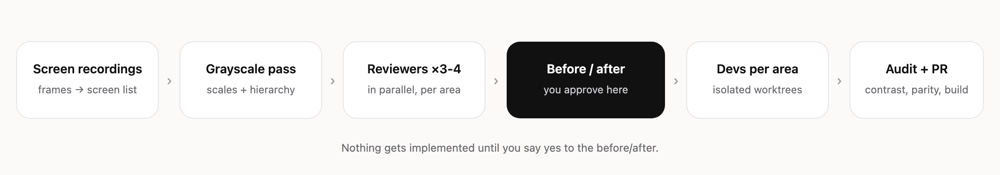

<h1 align="center">unslop-design</h1>

<p align="center">
  <b>An agent skill that makes your app stop looking AI-generated.</b><br>
  Claude Code · Codex · Cursor · Copilot · Gemini CLI · Windsurf · OpenCode and more.<br>
  57 numbered design fixes, two scripts that measure your UI, and a review process that shows you the before/after before touching your code.
</p>

<p align="center">
  <a href="#install">Install</a> ·
  <a href="#use-it">Use it</a> ·
  <a href="#the-57-fixes">The 57 fixes</a> ·
  <a href="#web-and-dashboards">Web</a> ·
  <a href="#how-it-works">How it works</a> ·
  <a href="#faq">FAQ</a>
</p>

<p align="center">
  
</p>

<p align="center"><sub>Real screenshots of <a href="https://refil.app">Refil</a>, same screen and city, before and after running the skill.</sub></p>

<p align="center">
  
  
  
  
  
</p>

---

## Why

AI-built UIs all drift to the same look: gradient backgrounds, an accent
color on everything, "Hey Alex! 👋" as the title, emoji as icons, badges
shouting in saturated pink, three numbers the same size, spacing picked by
eye. Each of those has a concrete fix. This skill gives your agent the list,
the reasons, and a way to apply them **one at a time** without you losing
control of the design.

## One fix at a time

Two Refil screens going through the checklist, each step labeled with the
area it touches. Every fix is applied and looked at on its own, so you can
see which one helped.

<table>
  <tr>
    <td align="center" width="50%"></td>
    <td align="center" width="50%"></td>
  </tr>
  <tr>
    <td align="center"><b>Map</b> · spacing → color → price → surface</td>
    <td align="center"><b>Profile</b> · title → color → savings → alerts</td>
  </tr>
</table>

<sub>The app is in Spanish. Full-quality MP4s: <a href="assets/videos/refil-mapa.mp4">map</a> · <a href="assets/videos/refil-perfil.mp4">profile</a>.</sub>

## Install

**Every agent on your machine, one command:**

```bash
curl -fsSL https://raw.githubusercontent.com/marcosnovo/unslop-design/main/install.sh | bash
```

It clones the skill once into `~/.agents/skills/unslop-design` and links it
into every agent it finds, so one `git pull` updates them all. Nothing is
overwritten: an existing folder with the same name is left alone.
`--dry-run` shows what it would do, `--copy` copies instead of linking, and
`--uninstall` removes only what it installed.
([Read the script](install.sh) before piping it into a shell.)

**Or one agent by hand.** Clone into its skills folder:

| Agent | Global folder | Call it |
|---|---|---|
| Claude Code | `~/.claude/skills/` | `/unslop-design` |
| Codex · Cline · Zed | `~/.agents/skills/` | `$unslop-design` (Codex) |
| Cursor | `~/.cursor/skills/` | ask for it by name |
| GitHub Copilot | `~/.copilot/skills/` | ask for it by name |
| Gemini CLI | `~/.gemini/skills/` | ask for it by name |
| Antigravity | `~/.gemini/antigravity/skills/` | ask for it by name |
| Windsurf | `~/.codeium/windsurf/skills/` | ask for it by name |
| OpenCode | `~/.config/opencode/skills/` | ask for it by name |
| Amp | `~/.config/agents/skills/` | ask for it by name |
| Kiro | `~/.kiro/skills/` | ask for it by name |
| Goose · Roo Code · Junie | `~/.config/goose/skills/` · `~/.roo/skills/` · `~/.junie/skills/` | ask for it by name |

```bash
git clone https://github.com/marcosnovo/unslop-design ~/.claude/skills/unslop-design
```

Every agent also picks it up on its own when the request matches (design
review, screenshots, "less AI"), so calling it by name is optional.

<details>
<summary>Only for one project, with the skills CLI, or in a chat app</summary>

- **One project:** clone it into `.agents/skills/unslop-design` inside the
  repo (Claude Code: `.claude/skills/`, Windsurf: `.windsurf/skills/`,
  Kiro: `.kiro/skills/`) and commit it, so your team and cloud sessions get
  it too.
- **[skills CLI](https://github.com/vercel-labs/skills):**
  `npx skills add marcosnovo/unslop-design -g`.
- **claude.ai, Claude desktop or ChatGPT:** download `unslop-design.zip`
  from the [latest release](https://github.com/marcosnovo/unslop-design/releases/latest)
  and upload it as a skill (Claude: Settings → Capabilities → Skills).
  Chat apps can review screenshots and draw the before/after; the parts
  that touch a codebase need a coding agent.

</details>

## Web and dashboards

<p align="center">
  
</p>

<p align="center"><sub><a href="examples/dashboard-before.html">examples/dashboard-before.html</a> → <a href="examples/dashboard-after.html">examples/dashboard-after.html</a>, rendered at 1280 px.</sub></p>

For a site or web app the agent also measures instead of eyeballing:

```bash
python3 scripts/slop-scan.py src/                      # gradients, glows, emoji, arbitrary values, raw colors… with file:line and fix #
node scripts/web-audit.mjs http://localhost:3000       # the rendered page at 390/768/1280 px
```

On the example above, `web-audit.mjs` goes from 19 spacing values (15 off
the scale), 5 weights, 6 radii, 6 shadows, a page that scrolls sideways
on a phone and 11 links with no focus style, to 6 spacing values, all on the scale, 2
weights, 1 shadow, no sideways scroll and a focus ring on everything.
`slop-scan.py` finds 91 hits in the before and none in the after. Details
in [`web.md`](web.md).

## Use it

Type `/unslop-design` (or `$unslop-design` in Codex), or just ask in plain
words. It triggers on its own
when you send screenshots or a screen recording and ask for design feedback.

```text
/unslop-design here's a screen recording of the onboarding, make it look less AI
```

```text
Review the design of the settings and profile screens and give me a proposal
```

```text
Audit our tokens: spacing, type scale, contrast in dark mode
```

Screen recordings need `ffmpeg` (`brew install ffmpeg`) so the agent can
pull frames from them.

## The 57 fixes

Every fix has a number so reviewers can cite it ("#20 badge is too loud")
and you can accept or reject them one by one. A few of them:

| # | Fix | Instead of |
|---|---|---|
| 1 | Non-linear spacing scale, neighbors ≥ 25% apart | `padding(13)`, `padding(15)`, `padding(18)` |
| 11 | Hierarchy with weight and color before size | three numbers fighting at the same size |
| 12 | "12 left in stock" | "Stock: 12" |
| 15 | Number and unit on one baseline | `$` and `/gal` vertically centered |
| 16 | Only numbers that exist | "vs. last month" with one month of data |
| 19 | One accent, for one gesture | brand color on cards, icons and titles |
| 20 | Quiet badges: dark text on a light tint | white on saturated pink |
| 22 | A shade of the same hue on colored panels | gray or 60% white text |
| 26 | The title says what the screen is | "Hey Alex! 👋" |
| 31 | Space, then background, then shadow, border last | a border around everything |
| 32 | Shadows mean height | shadows as decoration |
| 33 | One icon set, one stroke | emoji as icons, icons in colored circles |
| 39 | Charts: today saturated, values on the bars | gridlines and axes nobody reads |
| 41 | The primary button names where it goes | "Let's Go! 🚀" |
| 43 | One left and one right rail for everything | blocks starting at 12, 16 and 20 pt |
| 44 | One gap between sections, no filler copy | "✨ Share your best moments" |
| 47 | A signature taken from the domain, as a small family | a new font plus a glow |
| 50 | Counts as muted tabular numbers | `12` in a hot-pink pill, `210 👤` |
| 52 | A delta names its baseline | "+12%!!" |
| 55 | Ink headline on a neutral canvas | gradient text over a purple glow |

<details>
<summary><b>All 57, by section</b></summary>

**System** · 1 spacing scale · 2 type scale and two weights · 3 palette with
shades defined up front · 4 grays with one temperature · 5 named elevation
and radii · 6 a chosen personality

**Spacing** · 7 start with too much space · 8 more space around a group than
within · 9 uniform card padding · 10 you don't have to fill the screen

**Hierarchy** · 11 data first · 12 labels as a last resort · 13 small section
titles · 14 balance weight and contrast · 15 parts of a number · 16 only
numbers that exist · 17 each number once per screen · 18 what's next,
concretely

**Color** · 19 one accent · 20 quiet badges · 21 dark ink on brand fills ·
22 no gray on color · 23 neutral global tint · 24 color never alone

**Typography** · 25 sentence case · 26 title, not a greeting · 27 line height
and length · 28 align for readability · 29 letter-spacing with intent

**Decoration and depth** · 30 remove ornaments · 31 fewer borders · 32 shadows
mean height · 33 one icon style · 34 decoration with conditions

**Images and charts** · 35 good images or none · 36 text over images ·
37 user content in fixed frames · 38 screenshots at their size · 39 charts
without noise

**Layout** · 40 one card per idea · 41 action pyramid · 42 components don't
scale proportionally

**Chrome and signature** · 43 rails · 44 one section gap, no filler · 45
section headers are labels · 46 floating chrome in the system material,
content solid · 47 a signature is a family · 48 real content in every mock

**Web and dashboards** · 49 one icon slot · 50 counts are text, not pills ·
51 one category, one color · 52 a delta names its baseline · 53 interactive
states drawn · 54 shortcuts as keys · 55 no gradient text, no page glow ·
56 a data voice · 57 works at 390, 768 and 1280 px

Full text with the reason behind each one: [`checklist.md`](checklist.md).

</details>

## How it works

<p align="center">
  
</p>

1. **Inventory.** The agent pulls frames from your recordings, lists every
   screen and state, and finds each one in your code.
2. **System and grayscale pass.** It checks your spacing, type, color and
   shadow scales, then asks whether each screen still works without color.
   If it doesn't, the fix is hierarchy, not paint.
3. **Reviewers in parallel.** 3-4 agents acting as senior product designers,
   one per area, each drawing an HTML before/after, citing fix numbers and
   filling a spec card (Gap, Rails, Radius, Heads, Accent…).
   A jury agent merges them and resolves conflicts.
4. **You approve.** One published page with every before/after, the
   numbered decisions, what was dropped and the risks. Nothing is built
   until you say yes.
5. **Devs per area.** Agents in isolated git worktrees, each with a closed
   brief, so they don't step on each other. Shared tokens land first.
6. **Audit and PR.** Measured contrast, off-scale literals, platform parity,
   build checks. Then one PR, answers to review bots, and merge when green.

Small job? It scales down: a single screen gets the checklist and a
before/after without the whole team.

## Principles

1. A fix is a rule, not a tweak: it ships as a token or component.
2. Hierarchy before color: if it doesn't work in gray, color won't save it.
3. The first thing you read is the answer.
4. Color says one thing.
5. Contrast is measured, not assumed.
6. Nothing the screen can't deliver: no invented numbers.
7. One signature gesture, taken from the domain. Everything else native.
8. Platforms ship together.
9. Verify what the user sees: dark mode, largest text, long languages.

## What's in the repo

| File | What it covers |
|---|---|
| [`SKILL.md`](SKILL.md) | Principles and the short flow (what the agent reads first) |
| [`checklist.md`](checklist.md) | The 57 fixes, each with what to do and why |
| [`spec-card.md`](spec-card.md) | The card each reviewer fills: named values, ticked as they land |
| [`process.md`](process.md) | Inventory, reviewers, proposal, devs, verification, PR |
| [`platforms.md`](platforms.md) | SwiftUI, Compose, web, widgets, watch and car notes |
| [`web.md`](web.md) | Web playbook: finding tokens per stack, dashboards, landing pages, web PR checks |
| [`scripts/slop-scan.py`](scripts/slop-scan.py) | Finds slop patterns in source with file, line and fix number |
| [`scripts/web-audit.mjs`](scripts/web-audit.mjs) | Measures a rendered page: overflow, value census, contrast, focus |
| [`examples/`](examples) | One dashboard before and after, to try the scripts on |
| [`install.sh`](install.sh) | Installs or updates the skill for every agent it finds |
| [`scripts/validate.py`](scripts/validate.py) | Checks `SKILL.md` against the Agent Skills spec |
| [`agents/openai.yaml`](agents/openai.yaml) | Codex UI metadata (name, description, default prompt) |
| [`references.md`](references.md) | Six real before/afters and a chapter map of *Refactoring UI* |

## FAQ

<details>
<summary><b>Will it rewrite my app without asking?</b></summary>

No. The process stops at the before/after page and waits for your yes.
After that it works on branches and opens a PR; merging is up to your repo's
rules.
</details>

<details>
<summary><b>Which agent should I use? What changes between them?</b></summary>

Nothing in the rules: all of them read the same `SKILL.md` (the open
[Agent Skills](https://agentskills.io) format); Codex also reads
`agents/openai.yaml` for its UI. The parallel reviewers use subagents where
your tool has them, and run one after another where it doesn't. The
before/after is a published artifact in Claude Code and a local HTML file
elsewhere. The full process (parallel reviewers, worktrees, PR) works best
in agents with subagents and git: Claude Code, Codex, Cursor, Copilot.
</details>

<details>
<summary><b>Does it only work for iOS?</b></summary>

No. The checklist is platform-agnostic and `platforms.md` has notes for
SwiftUI, Jetpack Compose and the web, plus widgets, watch and car surfaces.
</details>

<details>
<summary><b>My project already has a design system.</b></summary>

Good. The skill uses your tokens and components, and when one of its rules
clashes with a written decision of yours, yours wins and the proposal says
so.
</details>

<details>
<summary><b>Isn't this just Refactoring UI?</b></summary>

It builds on it (and you should buy the book). The skill turns those ideas
into numbered, checkable fixes, adds what came up in real redesigns of
AI-built apps (invented numbers, greeting titles, emoji icons, carousels
hiding content), and is stricter where the book allows decoration that
AI-generated UIs overuse.
</details>

<details>
<summary><b>How much does a full run cost?</b></summary>

The full process spawns several agents (reviewers, a jury, devs, auditors),
so it uses noticeably more tokens than a normal chat. For one screen, ask
for the checklist review only.
</details>

## Credits

- *[Refactoring UI](https://www.refactoringui.com/)* by Adam Wathan and
  Steve Schoger, the source of many of the system rules.
- Built while redesigning [Refil](https://refil.app), a fuel price app for
  iOS and Android.
- The web fixes (#49-#57) started from Damir Sokolovsky's unslopping video
  of a dashboard on X.

## Contributing

Found a pattern of AI slop the checklist misses? Open an issue with a
before/after screenshot and the fix. See [CONTRIBUTING.md](CONTRIBUTING.md).

## License

[MIT](LICENSE)
