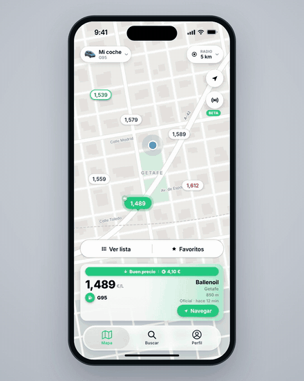
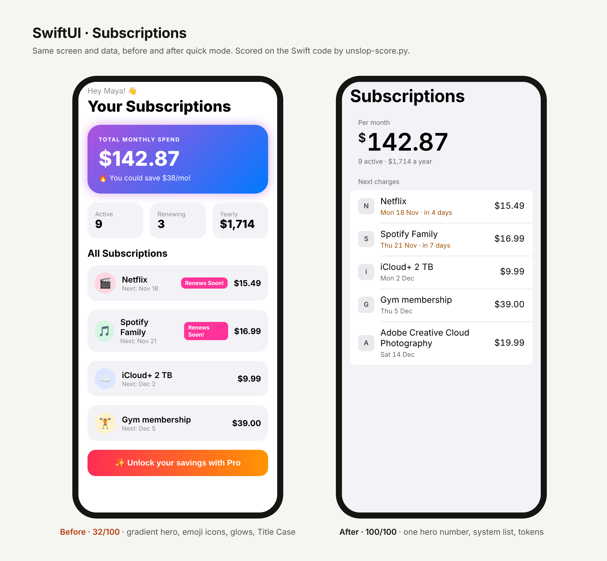
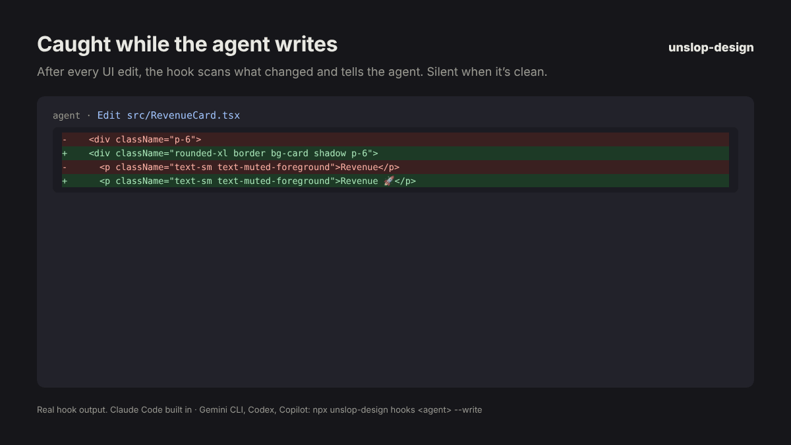
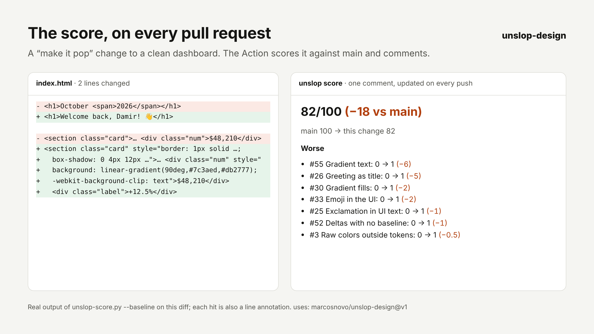

<h1 align="center">unslop-design</h1>

<p align="center">
  <b>An agent skill that makes your app stop looking AI-generated.</b><br>
  It reviews your UI, shows you the before/after, and applies 72 numbered design fixes one at a time.<br>
  Works with Claude Code · Codex · Cursor · Copilot · Gemini CLI · Windsurf · OpenCode and more.
</p>

<p align="center">
  <a href="https://marcosnovo.github.io/unslop-design/"><b>Website and live demo</b></a> ·
  <a href="#quick-start">Quick start</a> ·
  <a href="#use-it">Use it</a> ·
  <a href="#keep-it-clean">Hook and CI</a> ·
  <a href="#the-72-fixes">The 72 fixes</a> ·
  <a href="#guide">Guide</a>
</p>

<p align="center">
  
</p>

<p align="center"><sub>Real screenshots of <a href="https://refil.app">Refil</a>, same screen and city, before and after running the skill.</sub></p>

**What you get**

- **A review you can read.** Numbered fixes (#1-#72), each with its reason, so
  you accept or reject them one by one.
- **A before/after first.** Nothing in your code changes until you approve it.
- **A number, not a vibe.** Scripts measure your UI and score it from 0 to 100:
  the example dashboard goes from **21 to 100**, and 91 slop hits to none.

<p align="center">
  
  
  
  
  
  <a href="https://github.com/marcosnovo/unslop-design/releases/latest"></a>
</p>

## Quick start

**Claude Code**, as a plugin (updates with `/plugin update`):

```text
/plugin marketplace add marcosnovo/unslop-design
/plugin install unslop-design@unslop
```

**Any other agent** (Codex, Cursor, Copilot, Gemini CLI, Windsurf, OpenCode,
Devin, Trae, Qoder, Pi…), every one found on your machine at once:

```bash
npx unslop-design install
```

Or with the [skills CLI](https://github.com/vercel-labs/skills):

```bash
npx skills add marcosnovo/unslop-design -g
```

Pick one route per agent: installing the same skill twice makes it show up
twice. One project only, chat apps (claude.ai, ChatGPT) and manual clones:
[guide/install.md](guide/install.md).

**Check it works.** In a project, paste a screenshot and write *unslop this
screen*. You should get five numbered fixes, each with its reason, and a
before/after to approve before any code changes.

**Then, once per project:** *unslop init*. It reads your tokens, asks three
questions at most and writes `.unslop/context.md`, so your scales and brand
decisions are never flagged again.

---

## Why

AI-built UIs all drift to the same look: gradient backgrounds, an accent
color on everything, "Hey Alex! 👋" as the title, emoji as icons, badges
shouting in saturated pink, three numbers the same size, spacing picked by
eye. Each of those has a concrete fix. This skill gives your agent the list,
the reasons, and a way to apply them **one at a time** without you losing
control of the design.

## One fix at a time

Two Refil screens going through the checklist, each step labeled with the
area it touches. Every fix is applied and looked at on its own, so you can
see which one helped.

<table>
  <tr>
    <td align="center" width="50%"></td>
    <td align="center" width="50%"></td>
  </tr>
  <tr>
    <td align="center"><b>Map</b> · spacing → color → price → surface</td>
    <td align="center"><b>Profile</b> · title → color → savings → alerts</td>
  </tr>
</table>

<sub>The app is in Spanish. Full-quality MP4s: <a href="assets/videos/refil-mapa.mp4">map</a> · <a href="assets/videos/refil-perfil.mp4">profile</a>.</sub>

## Web and dashboards

<p align="center">
  
</p>

<p align="center"><sub><a href="examples/dashboard-before.html">examples/dashboard-before.html</a> → <a href="examples/dashboard-after.html">examples/dashboard-after.html</a>, rendered at 1280 px. Drag between the two on <a href="https://marcosnovo.github.io/unslop-design/#demo">the website</a>.</sub></p>

On this example `slop-scan.py` finds 91 hits before and none after, and the
score goes from 21 to 100; the rendered audit goes from 19 spacing values
and a sideways scroll on phones to 6 values on the scale and none. The web
playbook is [`web.md`](web.md).

## Native apps

<p align="center">
  
</p>

SwiftUI and Jetpack Compose are scanned like the web, not as an
afterthought: literals in views, elevation and stock-kit colors, emoji,
greetings, Title Case and rows of stat cards in `.swift` and `.kt` files.

| Example | Before | After |
|---|---|---|
| [`examples/swiftui/`](examples/swiftui) · subscriptions | 32/100: 10 emoji, glows, 4 gradients, 25 literals, "Hey Maya!" | 100/100 |
| [`examples/compose/`](examples/compose) · settings | 62/100: 7 emoji, 15 literals, the Android Studio template colors | 100/100 |

## Use it

Type `/unslop-design` (or `$unslop-design` in Codex), or just ask in plain
words. It triggers on its own
when you send screenshots or a screen recording and ask for design feedback.

```text
/unslop-design here's a screen recording of the onboarding, make it look less AI
```

```text
Review the design of the settings and profile screens and give me a proposal
```

```text
Audit our tokens: spacing, type scale, contrast in dark mode
```

With one screenshot or one screen the agent runs **quick mode**: no
subagents, the five fixes that change the screen most (each with its
number), the before/after, and on your yes it applies them and reports the
score. Several screens, a recording or "full review" switch to the full
process with parallel reviewers.

### Commands

You can also name what you want. With nothing attached and no command, the
agent reads where you left off and proposes the next two or three steps.

| Say | What you get |
|---|---|
| *unslop init* | `.unslop/context.md`: your users, scene, surfaces, scales and the decisions the checklist must respect |
| *unslop* + a screen | Quick mode: five fixes, before/after, applied on your yes |
| *unslop score* | The number and the trend ("41 → 88 → 91"), no proposal |
| *unslop audit* | Every finding ranked by fix number; changes nothing |
| *unslop critique* | A usability report: tasks walked as three users, cognitive load, ten heuristics scored 0-4, P0-P3 findings |
| *unslop apply* | The accepted fixes still pending in `.unslop/review.md`, one at a time |
| *unslop full* | The whole process with parallel reviewers ([how it works](guide/how-it-works.md)) |

How the score works, `--save`, `--baseline` and `--min`: [guide/automation.md](guide/automation.md).

## Keep it clean

A review fixes the screen; these keep the next edit from undoing it.

<table>
  <tr>
    <td width="50%"></td>
    <td width="50%"></td>
  </tr>
  <tr>
    <td align="center"><b>While the agent writes</b> · real hook output</td>
    <td align="center"><b>On the pull request</b> · real <code>--baseline</code> output</td>
  </tr>
</table>

- **While the agent writes.** After every edit to a UI file, a hook tells the
  agent what slop it just added, with the fix number, and says nothing when
  the edit is clean. Built into the Claude Code plugin; one command for
  Gemini CLI, Codex and Copilot (`npx unslop-design hooks gemini --write`).
- **On every pull request.** The GitHub Action annotates each line and keeps
  one comment with the score and the change against the base branch
  ("88/100, +7 vs main"), failing under your minimum if you set one.
- **Your decisions, once.** `.unslop/context.md` holds your scales and the
  rules your project allows, so a base-6 grid or a brand face isn't flagged
  twice.

```yaml
# .github/workflows/unslop.yml
on: pull_request
permissions: { contents: read, pull-requests: write }
jobs:
  unslop:
    runs-on: ubuntu-latest
    steps:
      - uses: actions/checkout@v5
      - uses: marcosnovo/unslop-design@v1
        with: { paths: src, min: 80 }
```

On the [GitHub Marketplace](https://github.com/marketplace/actions/unslop-design-score).
Every option, other agents and the local commands:
[guide/automation.md](guide/automation.md).

## The 72 fixes

Every fix has a number so reviewers can cite it ("#20 badge is too loud")
and you can accept or reject them one by one. Twelve of them:

| # | Fix | Instead of |
|---|---|---|
| 1 | Non-linear spacing scale, neighbors ≥ 25% apart | `padding(13)`, `padding(15)`, `padding(18)` |
| 11 | Hierarchy with weight and color before size | three numbers fighting at the same size |
| 19 | One accent, for one gesture | brand color on cards, icons and titles |
| 20 | Quiet badges: dark text on a light tint | white on saturated pink |
| 26 | The title says what the screen is | "Hey Alex! 👋" |
| 33 | One icon set, one stroke | emoji as icons, icons in colored circles |
| 41 | The primary button names where it goes | "Let's Go! 🚀" |
| 50 | Counts as muted tabular numbers | `12` in a hot-pink pill, `210 👤` |
| 52 | A delta names its baseline | "+12%!!" |
| 55 | Ink headline on a neutral canvas | gradient text over a purple glow |
| 68 | One separator per surface | a 1px border and a soft shadow on every card |
| 71 | Plurals, dates and money from the platform | "3 item(s)", a hand-built "MM/DD" |

All 72 with the reason behind each: [`checklist.md`](checklist.md) (by section:
[guide/how-it-works.md](guide/how-it-works.md#all-72-fixes-by-section)).

## Scores in the wild

Ran it on your own app or site? [Share the before/after and the
score](https://github.com/marcosnovo/unslop-design/issues/new?template=score-report.yml),
and it goes here with your permission: what the app is, the two numbers,
one image. What it missed is just as useful: that's how rules get added.

| App | Platform | Score | |
|---|---|---|---|
| [Refil](https://refil.app) (the author's) | iOS, Android | before/after above | [screens](#one-fix-at-a-time) |
| *Yours?* | | | [share it](https://github.com/marcosnovo/unslop-design/issues/new?template=score-report.yml) |

## Guide

- [Install](guide/install.md): every agent, one project only, chat apps, manual clone
- [Score, hook and CI](guide/automation.md): how the number works, the post-edit hook in each agent, the GitHub Action
- [How it works](guide/how-it-works.md): the full process with parallel reviewers, the principles, every file in the repo
- [FAQ](guide/faq.md): rewriting without asking, which agent, iOS only?, existing design systems, cost

## Contributing

Found a pattern of AI slop the checklist misses? Open an issue with a
before/after screenshot and the fix. See [CONTRIBUTING.md](CONTRIBUTING.md).

## Credits

- *[Refactoring UI](https://www.refactoringui.com/)* by Adam Wathan and
  Steve Schoger, the source of many of the system rules.
- Built while redesigning [Refil](https://refil.app), a fuel price app for
  iOS and Android.
- The web fixes (#49-#57) started from Damir Sokolovsky's unslopping video
  of a dashboard on X.
- #58 and #59 came from the developer of Utkik, who answered the launch
  post with "boxes have their purpose, but an app shouldn't only be built
  by them" — and a better-looking app to prove it.

## License

[MIT](LICENSE)
