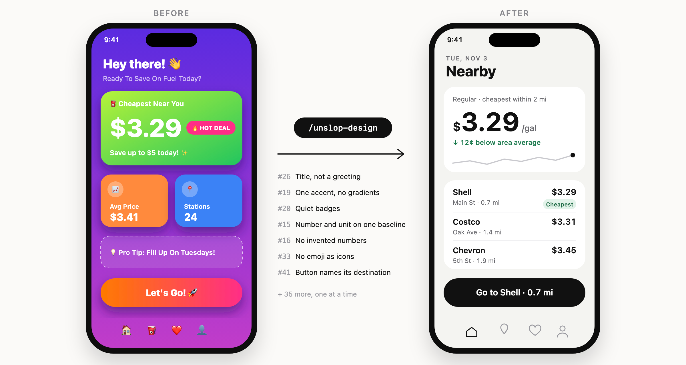
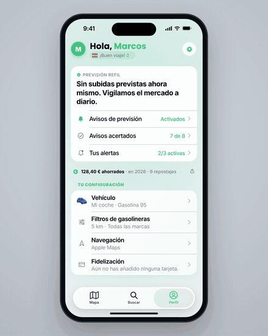
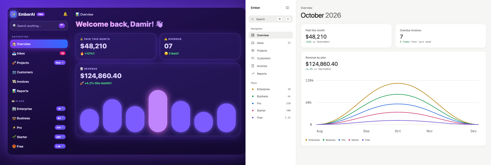
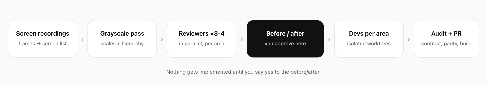

<h1 align="center">unslop-design</h1>

<p align="center">
  <b>An agent skill that makes your app stop looking AI-generated.</b><br>
  It reviews your UI, shows you the before/after, and applies 72 numbered design fixes one at a time.<br>
  Works with Claude Code · Codex · Cursor · Copilot · Gemini CLI · Windsurf · OpenCode and more.
</p>

<p align="center">
  <a href="https://marcosnovo.github.io/unslop-design/"><b>Website and live demo</b></a> ·
  <a href="#quick-start">Quick start</a> ·
  <a href="#use-it">Use it</a> ·
  <a href="#the-72-fixes">The 72 fixes</a> ·
  <a href="#keep-it-clean">Hook and CI</a> ·
  <a href="#web-and-dashboards">Web</a> ·
  <a href="#how-it-works">How it works</a> ·
  <a href="#faq">FAQ</a>
</p>

<p align="center">
  
</p>

<p align="center"><sub>Real screenshots of <a href="https://refil.app">Refil</a>, same screen and city, before and after running the skill.</sub></p>

**What you get**

- **A review you can read.** Numbered fixes (#1-#72), each with its reason, so
  you accept or reject them one by one.
- **A before/after first.** Nothing in your code changes until you approve it.
- **A number, not a vibe.** Scripts measure your UI and score it from 0 to 100:
  the example dashboard goes from **21 to 100**, and 91 slop hits to none.

<p align="center">
  
  
  
  
  
  <a href="https://github.com/marcosnovo/unslop-design/releases/latest"></a>
</p>

## Quick start

**Claude Code**, as a plugin (updates with `/plugin update`):

```text
/plugin marketplace add marcosnovo/unslop-design
/plugin install unslop-design@unslop
```

**Any other agent** (Codex, Cursor, Copilot, Gemini CLI, Windsurf, OpenCode,
Devin, Trae, Qoder, Pi…), every one found on your machine at once:

```bash
npx unslop-design install
```

Or with the [skills CLI](https://github.com/vercel-labs/skills):

```bash
npx skills add marcosnovo/unslop-design -g
```

Pick one route per agent: installing the same skill twice makes it show up
twice. Other routes (one command for every agent, one project only, chat
apps, manual clone) are in [More ways to install](#more-ways-to-install).

**Check it works.** In a project, paste a screenshot and write *unslop this
screen*. You should get five numbered fixes, each with its reason, and a
before/after to approve before any code changes.

**Then, once per project:** *unslop init*. It reads your tokens, asks three
questions at most and writes `.unslop/context.md`, so your scales and brand
decisions are never flagged again.

---

## Why

AI-built UIs all drift to the same look: gradient backgrounds, an accent
color on everything, "Hey Alex! 👋" as the title, emoji as icons, badges
shouting in saturated pink, three numbers the same size, spacing picked by
eye. Each of those has a concrete fix. This skill gives your agent the list,
the reasons, and a way to apply them **one at a time** without you losing
control of the design.

## One fix at a time

Two Refil screens going through the checklist, each step labeled with the
area it touches. Every fix is applied and looked at on its own, so you can
see which one helped.

<table>
  <tr>
    <td align="center" width="50%"></td>
    <td align="center" width="50%"></td>
  </tr>
  <tr>
    <td align="center"><b>Map</b> · spacing → color → price → surface</td>
    <td align="center"><b>Profile</b> · title → color → savings → alerts</td>
  </tr>
</table>

<sub>The app is in Spanish. Full-quality MP4s: <a href="assets/videos/refil-mapa.mp4">map</a> · <a href="assets/videos/refil-perfil.mp4">profile</a>.</sub>

## More ways to install

**Claude Code from a terminal:** `claude plugin marketplace add
marcosnovo/unslop-design && claude plugin install unslop-design@unslop`.
Update with `claude plugin marketplace update unslop && claude plugin update
unslop-design@unslop`. Plugin skills are namespaced, so the command is
`/unslop-design:unslop-design`; asking in plain words works the same.

**Every agent on your machine, one command:**

```bash
curl -fsSL https://raw.githubusercontent.com/marcosnovo/unslop-design/main/install.sh | bash
```

It clones the skill once into `~/.agents/skills/unslop-design` and links it
into every agent it finds, so one `git pull` updates them all. Nothing is
overwritten: an existing folder with the same name is left alone.
`--dry-run` shows what it would do, `--copy` copies instead of linking, and
`--uninstall` removes only what it installed.
([Read the script](install.sh) before piping it into a shell.)

**Or one agent by hand.** Clone into its skills folder:

| Agent | Global folder | Call it |
|---|---|---|
| Claude Code | `~/.claude/skills/` | `/unslop-design` |
| Codex · Replit · Cline · Zed | `~/.agents/skills/` | `$unslop-design` (Codex) |
| Cursor | `~/.cursor/skills/` | ask for it by name |
| GitHub Copilot | `~/.copilot/skills/` | ask for it by name |
| Gemini CLI | `~/.gemini/skills/` | ask for it by name |
| Antigravity | `~/.gemini/antigravity/skills/` | ask for it by name |
| Windsurf | `~/.codeium/windsurf/skills/` | ask for it by name |
| OpenCode | `~/.config/opencode/skills/` | ask for it by name |
| Amp | `~/.config/agents/skills/` | ask for it by name |
| Kiro | `~/.kiro/skills/` | ask for it by name |
| Goose · Roo Code · Junie | `~/.config/goose/skills/` · `~/.roo/skills/` · `~/.junie/skills/` | ask for it by name |
| Devin · Grok Build · Hermes | `~/.config/devin/skills/` · `~/.grok/skills/` · `~/.hermes/skills/` | ask for it by name |
| Pi · Oh My Pi · Qoder | `~/.pi/agent/skills/` · `~/.omp/agent/skills/` · `~/.qoder/skills/` | ask for it by name |
| Trae · Rovo Dev · Mistral Vibe · DeepSeek | `~/.trae/skills/` · `~/.rovodev/skills/` · `~/.vibe/skills/` · `~/.dsh/skills/` | ask for it by name |

```bash
git clone https://github.com/marcosnovo/unslop-design ~/.claude/skills/unslop-design
```

Every agent also picks it up on its own when the request matches (design
review, screenshots, "less AI"), so calling it by name is optional.

<details>
<summary>Only for one project, or in a chat app</summary>

- **One project:** clone it into `.agents/skills/unslop-design` inside the
  repo (Claude Code: `.claude/skills/`, Windsurf: `.windsurf/skills/`,
  Kiro: `.kiro/skills/`) and commit it, so your team and cloud sessions get
  it too.
- **claude.ai, Claude desktop or ChatGPT:** download `unslop-design.zip`
  from the [latest release](https://github.com/marcosnovo/unslop-design/releases/latest)
  and upload it as a skill (Claude: Settings → Capabilities → Skills).
  Chat apps can review screenshots and draw the before/after; the parts
  that touch a codebase need a coding agent.

</details>

## Web and dashboards

<p align="center">
  
</p>

<p align="center"><sub><a href="examples/dashboard-before.html">examples/dashboard-before.html</a> → <a href="examples/dashboard-after.html">examples/dashboard-after.html</a>, rendered at 1280 px. Drag between the two on <a href="https://marcosnovo.github.io/unslop-design/#demo">the website</a>.</sub></p>

For a site or web app the agent also measures instead of eyeballing:

```bash
python3 scripts/slop-scan.py src/                      # gradients, glows, emoji, raw colors, starter-kit defaults, rows of stat cards… with file:line and fix #
node scripts/web-audit.mjs http://localhost:3000       # the rendered page at 390/768/1280 px
```

On the example above, `web-audit.mjs` goes from 19 spacing values (15 off
the scale), 5 weights, 6 radii, 6 shadows, a page that scrolls sideways
on a phone and 11 links with no focus style, to 6 spacing values, all on the scale, 2
weights, 1 shadow, no sideways scroll and a focus ring on everything.
`slop-scan.py` finds 91 hits in the before and none in the after, and
`unslop-score.py` goes from 21 to 100 on the code alone. Details
in [`web.md`](web.md).

## Native apps

<p align="center">
  
</p>

SwiftUI and Jetpack Compose are scanned like the web, not as an
afterthought: literals in views, elevation and stock-kit colors, emoji,
greetings, Title Case and rows of stat cards in `.swift` and `.kt` files.

| Example | Before | After |
|---|---|---|
| [`examples/swiftui/`](examples/swiftui) · subscriptions | 32/100: 10 emoji, glows, 4 gradients, 25 literals, "Hey Maya!" | 100/100 |
| [`examples/compose/`](examples/compose) · settings | 62/100: 7 emoji, 15 literals, the Android Studio template colors | 100/100 |

```bash
python3 scripts/unslop-score.py examples/swiftui/before   # 32/100
python3 scripts/unslop-score.py examples/swiftui/after    # 100/100
```

The SwiftUI folders also hold the HTML mock of each state at iPhone size,
the way quick mode shows a native before/after when there's no simulator.

## Use it

Type `/unslop-design` (or `$unslop-design` in Codex), or just ask in plain
words. It triggers on its own
when you send screenshots or a screen recording and ask for design feedback.

```text
/unslop-design here's a screen recording of the onboarding, make it look less AI
```

```text
Review the design of the settings and profile screens and give me a proposal
```

```text
Audit our tokens: spacing, type scale, contrast in dark mode
```

With one screenshot or one screen the agent runs **quick mode**: no
subagents, the five fixes that change the screen most (each with its
number), the before/after, and on your yes it applies them and reports the
score. Several screens, a recording or "full review" switch to the full
process with parallel reviewers.

### Commands

You can also name what you want. With nothing attached and no command, the
agent reads where you left off and proposes the next two or three steps.

| Say | What you get |
|---|---|
| *unslop init* | `.unslop/context.md`: your users, scene, surfaces, scales and the decisions the checklist must respect |
| *unslop* + a screen | Quick mode: five fixes, before/after, applied on your yes |
| *unslop score* | The number and the trend ("41 → 88 → 91"), no proposal |
| *unslop audit* | Every finding ranked by fix number; changes nothing |
| *unslop critique* | A usability report: tasks walked as three users, cognitive load, ten heuristics scored 0-4, P0-P3 findings |
| *unslop apply* | The accepted fixes still pending in `.unslop/review.md`, one at a time |
| *unslop full* | The whole process below, with parallel reviewers |

### Score it

```bash
python3 scripts/unslop-score.py src/                                   # the code alone
python3 scripts/unslop-score.py src/ --audit unslop-audit/report.json  # plus the rendered page (web-audit.mjs)
```

```text
$ python3 scripts/unslop-score.py examples/dashboard-before.html
unslop score: 21/100 — slop  (1 source file)

Where the points went (fix the top rows first):
  -  12  [#32] Colored glows  (6)
  -  10  [#33] Emoji in the UI  (19)
  -   8  [#53] Focus outline removed  (1)
  …

Badge: [](https://github.com/marcosnovo/unslop-design)
```

Each kind of slop costs points per hit up to a cap, so the number says how
many kinds are left, not how big the codebase is. Paste the badge in your
README, and put "score 21 → 100" at the top of the PR. It's a smoke alarm,
not a judge: a 95 can still have a flat hierarchy. `--min 80` makes it exit
1 below 80 if you want it in a pre-commit hook, and `--save` keeps every run
in `.unslop/history.json` so the score has a trend.

## Keep it clean

A review fixes the screen; these keep the next edit from undoing it.

**While the agent writes (Claude Code).** The plugin ships a hook: after
every edit to a UI file it scans that file and tells the agent what slop the
edit just added, with the fix number. It says nothing when the edit is
clean, never changes code itself, and turns off with `UNSLOP_HOOK=off` or
`hook: off` in `.unslop/context.md`.

**On every pull request (GitHub Actions).** Each hit becomes an annotation
on its line, the score goes to the job summary, and the job fails under your
minimum:

```yaml
# .github/workflows/unslop.yml
on: pull_request
jobs:
  unslop:
    runs-on: ubuntu-latest
    steps:
      - uses: actions/checkout@v4
      - uses: marcosnovo/unslop-design@v1.11.0
        with:
          paths: src
          min: 80           # optional; also: allow, scale, type-scale
```

**Anywhere else.** `python3 scripts/slop-scan.py src --github` prints the
same annotations, `--json` every hit for other tools, and `--list-rules`
every rule id. All of them read `.unslop/context.md`, so your scale and your
allowed rules apply without flags.

Screen recordings need `ffmpeg` (`brew install ffmpeg`) so the agent can
pull frames from them.

## The 72 fixes

Every fix has a number so reviewers can cite it ("#20 badge is too loud")
and you can accept or reject them one by one. A few of them:

| # | Fix | Instead of |
|---|---|---|
| 1 | Non-linear spacing scale, neighbors ≥ 25% apart | `padding(13)`, `padding(15)`, `padding(18)` |
| 11 | Hierarchy with weight and color before size | three numbers fighting at the same size |
| 12 | "12 left in stock" | "Stock: 12" |
| 15 | Number and unit on one baseline | `$` and `/gal` vertically centered |
| 16 | Only numbers that exist | "vs. last month" with one month of data |
| 19 | One accent, for one gesture | brand color on cards, icons and titles |
| 20 | Quiet badges: dark text on a light tint | white on saturated pink |
| 22 | A shade of the same hue on colored panels | gray or 60% white text |
| 26 | The title says what the screen is | "Hey Alex! 👋" |
| 31 | Space, then background, then shadow, border last | a border around everything |
| 32 | Shadows mean height | shadows as decoration |
| 33 | One icon set, one stroke | emoji as icons, icons in colored circles |
| 39 | Charts: today saturated, values on the bars | gridlines and axes nobody reads |
| 41 | The primary button names where it goes | "Let's Go! 🚀" |
| 43 | One left and one right rail for everything | blocks starting at 12, 16 and 20 pt |
| 44 | One gap between sections, no filler copy | "✨ Share your best moments" |
| 47 | A signature taken from the domain, as a small family | a new font plus a glow |
| 50 | Counts as muted tabular numbers | `12` in a hot-pink pill, `210 👤` |
| 52 | A delta names its baseline | "+12%!!" |
| 55 | Ink headline on a neutral canvas | gradient text over a purple glow |
| 68 | One separator per surface | a 1px border and a soft shadow on every card |
| 70 | A modal is the last resort; Undo beats Confirm | "Are you sure?" before every delete |
| 71 | Plurals, dates and money from the platform | "3 item(s)", a hand-built "MM/DD" |
| 72 | Four choices or fewer per group | nine filter chips in a row |

<details>
<summary><b>All 72, by section</b></summary>

**System** · 1 spacing scale · 2 type scale and two weights · 3 palette with
shades defined up front · 4 grays with one temperature · 5 named elevation
and radii · 6 a chosen personality

**Spacing** · 7 start with too much space · 8 more space around a group than
within · 9 uniform card padding · 10 you don't have to fill the screen

**Hierarchy** · 11 data first · 12 labels as a last resort · 13 small section
titles · 14 balance weight and contrast · 15 parts of a number · 16 only
numbers that exist · 17 each number once per screen · 18 what's next,
concretely

**Color** · 19 one accent · 20 quiet badges · 21 dark ink on brand fills ·
22 no gray on color · 23 neutral global tint · 24 color never alone

**Typography** · 25 sentence case · 26 title, not a greeting · 27 line height
and length · 28 align for readability · 29 letter-spacing with intent · 69
code faces for code and data

**Decoration and depth** · 30 remove ornaments · 31 fewer borders · 32 shadows
mean height · 33 one icon style · 34 decoration with conditions · 66 a hard
offset shadow is a style · 68 one separator per surface

**Images and charts** · 35 good images or none · 36 text over images ·
37 user content in fixed frames · 38 screenshots at their size · 39 charts
without noise

**Layout** · 40 one card per idea · 41 action pyramid · 42 components don't
scale proportionally · 70 a modal is the last resort · 72 four choices or
fewer per group

**Chrome and signature** · 43 rails · 44 one section gap, no filler · 45
section headers are quiet labels · 46 floating chrome in the system material,
content solid · 47 a signature is a family · 48 real content in every mock

**Web and dashboards** · 49 one icon slot · 50 counts are text, not pills ·
51 one category, one color · 52 a delta names its baseline · 53 interactive
states drawn · 54 shortcuts as keys · 55 no gradient text, no page glow ·
56 a data voice · 57 works at 390, 768 and 1280 px

**Beyond clean** · 58 objects before boxes · 59 when the content is a canvas,
chrome floats · 65 a skeleton from the job, not from the template

**Craft floor** · 60 structure carries information or goes · 61 real
typography characters · 62 system surfaces wear the theme · 63 motion is
named, short and optional · 64 nothing invented, nothing inflated · 67 ease
out, don't bounce · 71 built for every language and every size of data

Full text with the reason behind each one: [`checklist.md`](checklist.md).

</details>

## How it works

<p align="center">
  
</p>

1. **Inventory.** The agent pulls frames from your recordings, lists every
   screen and state, and finds each one in your code.
2. **System and grayscale pass.** It checks your spacing, type, color and
   shadow scales, then asks whether each screen still works without color.
   If it doesn't, the fix is hierarchy, not paint.
3. **Reviewers in parallel.** 3-4 agents acting as senior product designers,
   one per area, each drawing an HTML before/after, citing fix numbers and
   filling a spec card (Gap, Rails, Radius, Heads, Accent…).
   A jury agent merges them and resolves conflicts.
4. **You approve.** One published page with every before/after, the
   numbered decisions, what was dropped and the risks. Nothing is built
   until you say yes.
5. **Devs per area.** Agents in isolated git worktrees, each with a closed
   brief, so they don't step on each other. Shared tokens land first.
6. **Audit and PR.** Measured contrast, off-scale literals, platform parity,
   build checks. Then one PR, answers to review bots, and merge when green.

Small job? It scales down: a single screen gets the checklist and a
before/after without the whole team.

## Principles

1. A fix is a rule, not a tweak: it ships as a token or component.
2. Hierarchy before color: if it doesn't work in gray, color won't save it.
3. The first thing you read is the answer.
4. Color says one thing.
5. Contrast is measured, not assumed.
6. Nothing the screen can't deliver: no invented numbers.
7. One signature gesture, taken from the domain. Everything else native.
8. Platforms ship together.
9. Verify what the user sees: dark mode, largest text, long languages.

## What's in the repo

<details>
<summary>Files and scripts</summary>

| File | What it covers |
|---|---|
| [`SKILL.md`](SKILL.md) | Principles, quick mode and the full flow (what the agent reads first) |
| [`checklist.md`](checklist.md) | The 72 fixes, each with what to do and why |
| [`context.md`](context.md) | `init`: the `.unslop/context.md` template, `review.md` backlog and what scripts read |
| [`critique.md`](critique.md) | The usability report: tasks, cognitive load, ten heuristics, severities |
| [`spec-card.md`](spec-card.md) | The card each reviewer fills: named values, ticked as they land |
| [`process.md`](process.md) | Inventory, reviewers, proposal, devs, verification, PR |
| [`platforms.md`](platforms.md) | SwiftUI, Compose, web, widgets, watch and car notes |
| [`web.md`](web.md) | Web playbook: finding tokens per stack, dashboards, landing pages, web PR checks |
| [`scripts/slop-scan.py`](scripts/slop-scan.py) | Finds slop patterns in source with file, line and fix number |
| [`scripts/web-audit.mjs`](scripts/web-audit.mjs) | Measures a rendered page: overflow, value census, contrast, focus |
| [`scripts/unslop-score.py`](scripts/unslop-score.py) | Both as one score from 0 to 100, with the breakdown and a badge |
| [`examples/`](examples) | Before/after pairs to try the scripts on: a web dashboard, a SwiftUI screen, a Compose screen |
| [`.claude-plugin/`](.claude-plugin) | Claude Code plugin and marketplace manifests |
| [`hooks/`](hooks) | The Claude Code hook that scans each UI edit |
| [`action.yml`](action.yml) | The GitHub Action: annotations, job summary, minimum score |
| [`bin/unslop.mjs`](bin/unslop.mjs) | `npx unslop-design install / scan / score / audit / rules` |
| [`docs/`](docs) | The landing page (GitHub Pages) with the live before/after |
| [`install.sh`](install.sh) | Installs or updates the skill for every agent it finds |
| [`scripts/validate.py`](scripts/validate.py) | Checks `SKILL.md` against the Agent Skills spec |
| [`scripts/test.py`](scripts/test.py) | Regression tests: every case in `tests/cases` gives exactly the hits `tests/expected.json` lists |
| [`agents/openai.yaml`](agents/openai.yaml) | Codex UI metadata (name, description, default prompt) |
| [`references.md`](references.md) | Six real before/afters, one reference app and a chapter map of *Refactoring UI* |

</details>

## FAQ

<details>
<summary><b>Will it rewrite my app without asking?</b></summary>

No. The process stops at the before/after page and waits for your yes.
After that it works on branches and opens a PR; merging is up to your repo's
rules.
</details>

<details>
<summary><b>Which agent should I use? What changes between them?</b></summary>

Nothing in the rules: all of them read the same `SKILL.md` (the open
[Agent Skills](https://agentskills.io) format); Codex also reads
`agents/openai.yaml` for its UI. The parallel reviewers use subagents where
your tool has them, and run one after another where it doesn't. The
before/after is a published artifact in Claude Code and a local HTML file
elsewhere. The full process (parallel reviewers, worktrees, PR) works best
in agents with subagents and git: Claude Code, Codex, Cursor, Copilot.
</details>

<details>
<summary><b>Does it only work for iOS?</b></summary>

No. The checklist is platform-agnostic and `platforms.md` has notes for
SwiftUI, Jetpack Compose and the web, plus widgets, watch and car surfaces.
</details>

<details>
<summary><b>My project already has a design system.</b></summary>

Good. The skill uses your tokens and components, and when one of its rules
clashes with a written decision of yours, yours wins and the proposal says
so.
</details>

<details>
<summary><b>Isn't this just Refactoring UI?</b></summary>

It builds on it (and you should buy the book). The skill turns those ideas
into numbered, checkable fixes, adds what came up in real redesigns of
AI-built apps (invented numbers, greeting titles, emoji icons, carousels
hiding content), and is stricter where the book allows decoration that
AI-generated UIs overuse.
</details>

<details>
<summary><b>How much does a full run cost?</b></summary>

The full process spawns several agents (reviewers, a jury, devs, auditors),
so it uses noticeably more tokens than a normal chat. For one screen, ask
for the checklist review only.
</details>

## Credits

- *[Refactoring UI](https://www.refactoringui.com/)* by Adam Wathan and
  Steve Schoger, the source of many of the system rules.
- Built while redesigning [Refil](https://refil.app), a fuel price app for
  iOS and Android.
- The web fixes (#49-#57) started from Damir Sokolovsky's unslopping video
  of a dashboard on X.
- #58 and #59 came from the developer of Utkik, who answered the launch
  post with "boxes have their purpose, but an app shouldn't only be built
  by them" — and a better-looking app to prove it.

## Contributing

Found a pattern of AI slop the checklist misses? Open an issue with a
before/after screenshot and the fix. See [CONTRIBUTING.md](CONTRIBUTING.md).

## License

[MIT](LICENSE)
