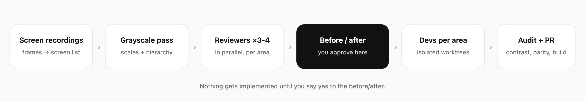

# How it works

The full process, the principles behind every fix, and what each file in the repo does.

## How it works

  

1. **Inventory.** The agent pulls frames from your recordings, lists every
   screen and state, and finds each one in your code.
2. **System and grayscale pass.** It checks your spacing, type, color and
   shadow scales, then asks whether each screen still works without color.
   If it doesn't, the fix is hierarchy, not paint.
3. **Reviewers in parallel.** 3-4 agents acting as senior product designers,
   one per area, each drawing an HTML before/after, citing fix numbers and
   filling a spec card (Gap, Rails, Radius, Heads, Accent…).
   A jury agent merges them and resolves conflicts.
4. **You approve.** One published page with every before/after, the
   numbered decisions, what was dropped and the risks. Nothing is built
   until you say yes.
5. **Devs per area.** Agents in isolated git worktrees, each with a closed
   brief, so they don't step on each other. Shared tokens land first.
6. **Audit and PR.** Measured contrast, off-scale literals, platform parity,
   build checks. Then one PR, answers to review bots, and merge when green.

Small job? It scales down: a single screen gets the checklist and a
before/after without the whole team.

## Principles

1. A fix is a rule, not a tweak: it ships as a token or component.
2. Hierarchy before color: if it doesn't work in gray, color won't save it.
3. The first thing you read is the answer.
4. Color says one thing.
5. Contrast is measured, not assumed.
6. Nothing the screen can't deliver: no invented numbers.
7. One signature gesture, taken from the domain. Everything else native.
8. Platforms ship together.
9. Verify what the user sees: dark mode, largest text, long languages.

## What's in the repo

Files and scripts

| File | What it covers |
|---|---|
| [`SKILL.md`](../SKILL.md) | Principles, quick mode and the full flow (what the agent reads first) |
| [`checklist.md`](../checklist.md) | The 72 fixes, each with what to do and why |
| [`context.md`](../context.md) | `init`: the `.unslop/context.md` template, `review.md` backlog and what scripts read |
| [`critique.md`](../critique.md) | The usability report: tasks, cognitive load, ten heuristics, severities |
| [`spec-card.md`](../spec-card.md) | The card each reviewer fills: named values, ticked as they land |
| [`process.md`](../process.md) | Inventory, reviewers, proposal, devs, verification, PR |
| [`platforms.md`](../platforms.md) | SwiftUI, Compose, web, widgets, watch and car notes |
| [`web.md`](../web.md) | Web playbook: finding tokens per stack, dashboards, landing pages, web PR checks |
| [`scripts/slop-scan.py`](../scripts/slop-scan.py) | Finds slop patterns in source with file, line and fix number |
| [`scripts/web-audit.mjs`](../scripts/web-audit.mjs) | Measures a rendered page: overflow, value census, contrast, focus |
| [`scripts/unslop-score.py`](../scripts/unslop-score.py) | Both as one score from 0 to 100, with the breakdown and a badge |
| [`examples/`](../examples) | Before/after pairs to try the scripts on: a web dashboard, a SwiftUI screen, a Compose screen |
| [`.claude-plugin/`](../.claude-plugin) | Claude Code plugin and marketplace manifests |
| [`hooks/`](../hooks) | The Claude Code hook that scans each UI edit |
| [`action.yml`](../action.yml) | The GitHub Action: annotations, job summary, minimum score |
| [`bin/unslop.mjs`](../bin/unslop.mjs) | `npx unslop-design install / scan / score / audit / rules` |
| [`docs/`](../docs) | The landing page (GitHub Pages) with the live before/after |
| [`install.sh`](../install.sh) | Installs or updates the skill for every agent it finds |
| [`scripts/validate.py`](../scripts/validate.py) | Checks `SKILL.md` against the Agent Skills spec |
| [`scripts/test.py`](../scripts/test.py) | Regression tests: every case in `tests/cases` gives exactly the hits `tests/expected.json` lists |
| [`agents/openai.yaml`](../agents/openai.yaml) | Codex UI metadata (name, description, default prompt) |
| [`references.md`](../references.md) | Six real before/afters, one reference app and a chapter map of *Refactoring UI* |

## All 72 fixes by section

**System** · 1 spacing scale · 2 type scale and two weights · 3 palette with
shades defined up front · 4 grays with one temperature · 5 named elevation
and radii · 6 a chosen personality

**Spacing** · 7 start with too much space · 8 more space around a group than
within · 9 uniform card padding · 10 you don't have to fill the screen

**Hierarchy** · 11 data first · 12 labels as a last resort · 13 small section
titles · 14 balance weight and contrast · 15 parts of a number · 16 only
numbers that exist · 17 each number once per screen · 18 what's next,
concretely

**Color** · 19 one accent · 20 quiet badges · 21 dark ink on brand fills ·
22 no gray on color · 23 neutral global tint · 24 color never alone

**Typography** · 25 sentence case · 26 title, not a greeting · 27 line height
and length · 28 align for readability · 29 letter-spacing with intent · 69
code faces for code and data

**Decoration and depth** · 30 remove ornaments · 31 fewer borders · 32 shadows
mean height · 33 one icon style · 34 decoration with conditions · 66 a hard
offset shadow is a style · 68 one separator per surface

**Images and charts** · 35 good images or none · 36 text over images ·
37 user content in fixed frames · 38 screenshots at their size · 39 charts
without noise

**Layout** · 40 one card per idea · 41 action pyramid · 42 components don't
scale proportionally · 70 a modal is the last resort · 72 four choices or
fewer per group

**Chrome and signature** · 43 rails · 44 one section gap, no filler · 45
section headers are quiet labels · 46 floating chrome in the system material,
content solid · 47 a signature is a family · 48 real content in every mock

**Web and dashboards** · 49 one icon slot · 50 counts are text, not pills ·
51 one category, one color · 52 a delta names its baseline · 53 interactive
states drawn · 54 shortcuts as keys · 55 no gradient text, no page glow ·
56 a data voice · 57 works at 390, 768 and 1280 px

**Beyond clean** · 58 objects before boxes · 59 when the content is a canvas,
chrome floats · 65 a skeleton from the job, not from the template

**Craft floor** · 60 structure carries information or goes · 61 real
typography characters · 62 system surfaces wear the theme · 63 motion is
named, short and optional · 64 nothing invented, nothing inflated · 67 ease
out, don't bounce · 71 built for every language and every size of data

Full text with the reason behind each one: [`checklist.md`](../checklist.md).

---

[← Back to the README](../README.md)
